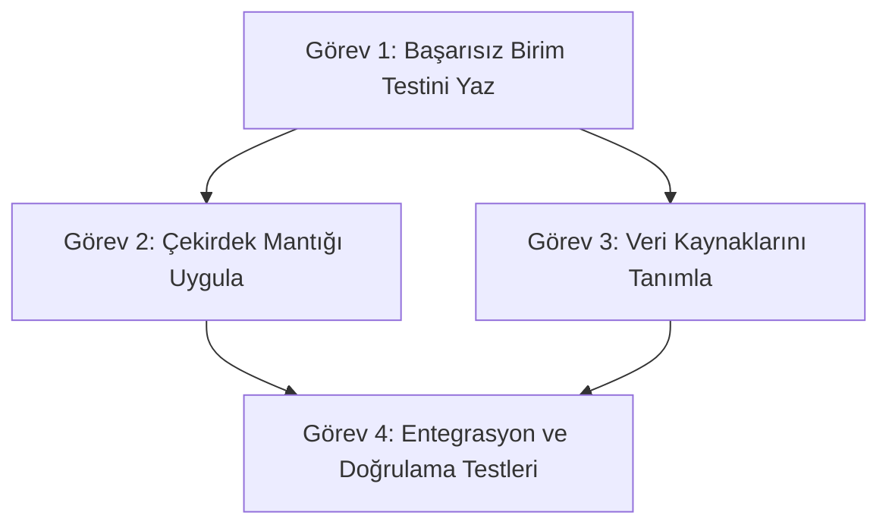

# Plan: [Görev / Özellik Adı] (Şartname: [spec-id.md])
Mühendis / Koordinatör: [Rol] · Durum: [taslak | onaylandı | yürütülüyor | tamamlandı] · Tarih: [YYYY-AA-GG]

## 1. Değişecek Dosyalar ve Yazma Kapsamları (Write Scopes)
| Dosya Yolu | İşlem Türü | Sorumlu Alt Ajan / Uzman |
| :--- | :--- | :--- |
| `src/player/...` | Düzenleme | `godot-gdscript-specialist` |
| `tests/unit/...` | Yeni Dosya | `qa-tester` |
| `project.godot` | Salt Okunur / Kontrol | `lead-programmer` |

## 2. Görev Bağımlılık Çizelgesi (Task DAG)

## 3. Adım Adım İş Sırası
1. **Adım 1 (Test-First):** İstenen davranışı doğrulayan ancak şu anda başarısız olan testi yaz ve doğrula.
2. **Adım 2 (Uygulama):** Şartnamede tanımlanan sınıfları ve metodları statik tipli GDScript standartlarına uygun olarak kodla.
3. **Adım 3 (Doğrulama):** Testleri headless modda çalıştır (`runner.py test` veya `godot --headless`).
4. **Adım 4 (Görsel / Entegrasyon İncelemesi):** Ekran görüntüsü veya oyun içi log kanıtlarını topla.

## 4. Riskler ve Acil Durum Tedbirleri
- **Olası Çakışma:** Başka bir subagent aynı dosyaya dokunamaz; yazma kapsamı dışına çıkış yasaktır.
- **Geri Alma (Rollback) Planı:** Başarısızlık durumunda değişiklikler git ile geri alınabilir olmalıdır.

## 5. Doğrulama Kanıtları (Evidence)
- **Komut:** `python tools/sdlc/runner.py test --filter [test_adı]`
- **Beklenen Çıktı:** 0 failures, 0 errors.

---
## Kullanıcı İzni ve Yürütme Onayı
- [ ] Kullanıcı bu planı ve dosya kapsamını inceleyip onayladı.
- [ ] Otomatik mod (Auto Mode) veya alt ajan yürütmesi başlatıldı.
